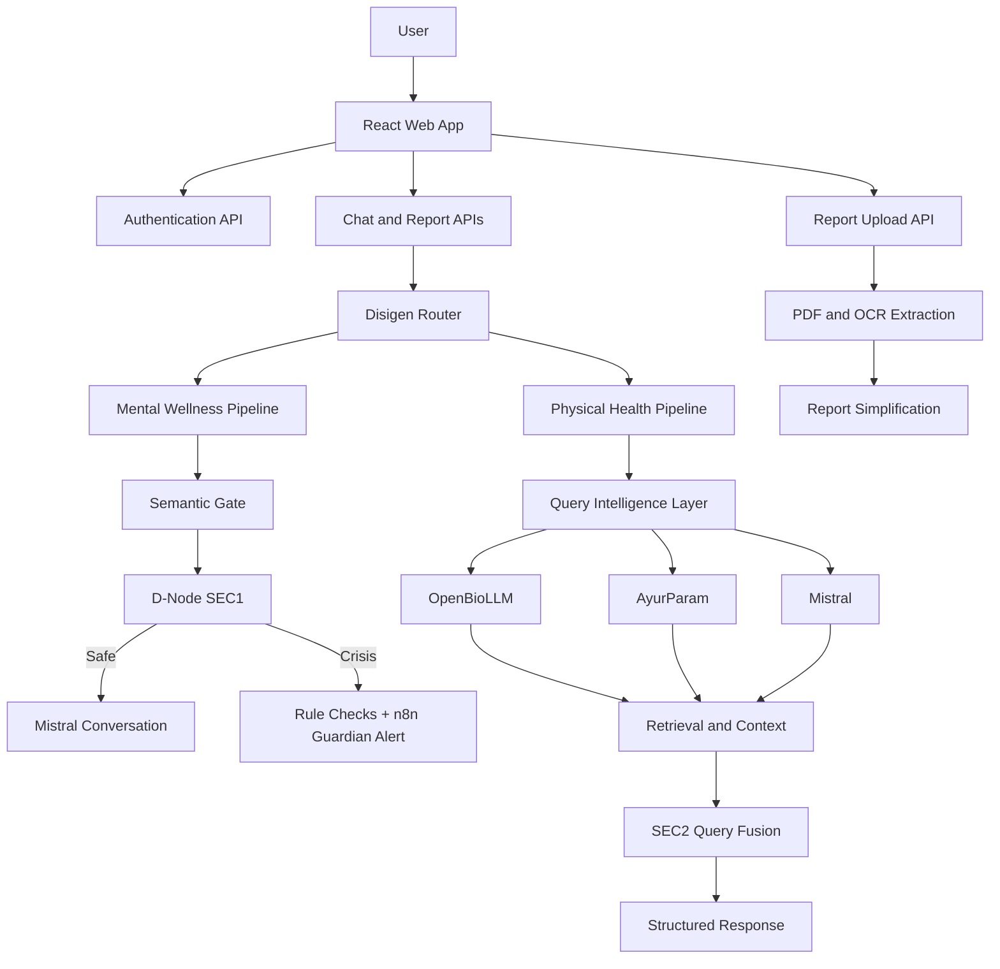

<div align="center">


# ⚕️ ReassureAI

### A Hybrid AI Healthcare Support System

_Bridging modern biomedicine with Ayurvedic wisdom_

[](LICENSE)
[](https://www.python.org/)
[](https://react.dev/)
[](https://fastapi.tiangolo.com/)
[]()

**Mental wellness support · Medical report simplification · Ayurvedic guidance**

</div>

---

## Overview

ReassureAI is an academic research project that explores how multiple AI models,
retrieval-augmented generation, and safety checks can support access to
health-related information.

The application provides:

- Supportive mental wellness conversations with crisis detection.
- Plain-language explanations of uploaded medical reports.
- Combined biomedical and Ayurvedic perspectives for physical-health questions.
- A React web interface with authentication, chat history, report history,
  text-to-speech, and message feedback.

ReassureAI is a proof of concept, not a medical device or diagnostic service.
See the [disclaimer](#disclaimer) before using it.

## Features

### Mental wellness support

- Empathetic conversational responses through the mental-health pipeline.
- Semantic crisis screening before response generation.
- Rule-based safety checks and an optional n8n guardian-alert workflow.
- Conversation history stored per authenticated user.

### Medical report simplification

- Upload PDF and image-based reports.
- Text extraction using PDF and OCR utilities.
- Duplicate detection using file hashing.
- Plain-language report summaries generated through the configured model service.
- Saved report history and processing status.

### Physical-health and Ayurvedic guidance

- Query routing through the Query Intelligence Layer (QIL).
- Biomedical reasoning through OpenBioLLM.
- Ayurvedic reasoning through AyurParam.
- Mistral support for routing, semantic analysis, and response fusion.
- Retrieval support through Qdrant and local retrieval components.
- Post-generation fusion for contradictions, herb-drug conflicts, and disclaimers.

### Web application

- Registration, login, logout, and authenticated routes.
- Dashboard, chat, journal, and report views.
- Markdown-rendered assistant responses.
- Copy, regenerate, text-to-speech, like, and dislike actions.
- Responsive interface with light and dark theme support.

## Architecture



### Safety checkpoints

1. **SEC1 — Pre-inference safety:** the semantic gate and D-Node evaluate
   mental-health messages before the conversational response is generated.
2. **SEC2 — Post-inference safety:** the fusion layer checks generated
   responses, identifies contradictions and herb-drug conflicts, and adds
   safety disclaimers where appropriate.

Safety automation depends on the configured n8n workflows. The application
must not be treated as an emergency response service.

## Technology stack

| Layer | Technologies |
| --- | --- |
| Frontend | React 19, Vite, React Router, Tailwind CSS, Framer Motion |
| Backend | Python 3.11+, FastAPI, Uvicorn, Pydantic Settings |
| Database | MongoDB, Motor, Beanie |
| Retrieval | Qdrant, embedding configuration for `BAAI/bge-m3`, local retrieval utilities |
| AI services | Ollama, OpenBioLLM-8B, AyurParam GGUF, Mistral, optional Hugging Face and Groq integrations |
| Document processing | PyPDF2, Pillow, pdf2image, pytesseract |
| Automation | n8n webhooks for welcome and crisis email workflows |
| Deployment | Docker Compose, Caddy reverse proxy |

## Models and external services

| Model or service | Purpose |
| --- | --- |
| [OpenBioLLM-8B](https://huggingface.co/aaditya/Llama3-OpenBioLLM-8B) | Biomedical reasoning |
| [AyurParam GGUF](https://huggingface.co/A-Aryam/AyurParam-GGUF) | Ayurvedic reasoning through local inference |
| Mistral | Mental-health conversation, semantic analysis, routing, and fusion |
| `BAAI/bge-m3` | Embeddings for retrieval workflows |
| Ollama | Local model serving |
| Qdrant Cloud | Vector collections for retrieval |
| MongoDB | Users, conversations, feedback, and report metadata |
| n8n | Welcome-email and crisis-guardian workflow automation |

The model availability and quality depend on the local machine, configured
provider credentials, model versions, and retrieval data.

## Getting started

### Prerequisites

For the recommended Docker workflow:

- Docker Engine or Docker Desktop with Compose.
- At least one configured model provider:
  - Ollama running on the host, or
  - the configured Hugging Face/Groq integration.
- The models and credentials required by the features you want to use.

For host-based development:

- Python 3.11 or newer.
- Node.js 18 or newer.
- MongoDB.
- Ollama, if using local model inference.
- `make` and a Unix-like shell. Windows users can use WSL2.

### Option A: Docker Compose

1. Clone the repository:

   ```bash
   git clone https://github.com/Aaryam-7d6/ReassureAI.git
   cd ReassureAI
   ```

2. Create the local environment file:

   ```bash
   cp .env.copy .env
   ```

   Edit `.env` and provide the secrets and provider settings required for
   your environment. Never commit `.env`.

3. Start the stack:

   ```bash
   docker compose up --build
   ```

4. Open the application:

   - Web app: <http://localhost:8080>
   - FastAPI documentation: <http://localhost:8080/docs>
   - n8n editor: <http://localhost:5678>

The Compose stack runs Caddy, the frontend, backend, MongoDB, and n8n.
MongoDB, n8n data, uploads, and other runtime state are stored locally under
the ignored `data/` directory or in named Docker volumes.

To stop the stack:

```bash
docker compose down
```

To stop it and remove named volumes:

```bash
docker compose down -v
```

### Option B: Host-based development

1. Create a Python environment and install backend dependencies:

   ```bash
   python3 -m venv .venv
   source .venv/bin/activate
   pip install -r backend/requirements.txt
   ```

2. Install frontend dependencies:

   ```bash
   cd frontend
   npm install
   cd ..
   ```

3. Create `.env` from the example and configure MongoDB, model providers, and
   CORS settings:

   ```bash
   cp .env.copy .env
   ```

4. Start both development servers:

   ```bash
   make dev
   ```

   The frontend runs on <http://localhost:5173> and the backend runs on
   <http://localhost:8000>.

The root [Makefile](Makefile) also provides `make install`, `make backend`,
`make frontend`, and `make seed`.

### Environment configuration

The complete variable list is documented in [.env.copy](.env.copy).
Important settings include:

| Variable | Purpose |
| --- | --- |
| `MONGODB_URI` / `MONGO_URI` | MongoDB connection string |
| `JWT_SECRET` | Secret used to sign authentication tokens |
| `OLLAMA_BASE_URL` / `OLLAMA_URL` | Ollama service URL |
| `OPENBIO_MODEL_NAME` | Biomedical model identifier |
| `HUGGINGFACE_API_KEY` | Optional Hugging Face provider credential |
| `GROQ_API_KEY` | Optional Groq provider credential |
| `QDRANT_URL` / `QDRANT_API_KEY` | Optional Qdrant connection |
| `UPLOAD_DIR` | Local report-upload directory |
| `N8N_WELCOME_WEBHOOK_URL` | Welcome-email workflow endpoint |
| `N8N_CRISIS_WEBHOOK_URL` | Crisis-alert workflow endpoint |
| `CORS_ORIGINS` | Allowed frontend origins |

Generate a strong JWT secret with:

```bash
python3 -c "import secrets; print(secrets.token_hex(64))"
```

### Local Ollama models

Model names depend on the Ollama models installed on your machine. For the
default local setup, make the configured Mistral and AyurParam models
available, for example:

```bash
ollama pull mistral
ollama run hf.co/A-Aryam/AyurParam-GGUF:Q4_K_M
```

The biomedical pipeline can use the configured Hugging Face or Groq provider
when those credentials are available.

## API overview

The backend exposes interactive OpenAPI documentation at `/docs`.

| Area | Routes |
| --- | --- |
| Health | `GET /health`, `GET /api/v1/health` |
| Authentication | `POST /api/v1/auth/register`, `POST /api/v1/auth/login`, `POST /api/v1/auth/logout`, `GET /api/v1/auth/me` |
| Chat | `POST /api/v1/chat`, `GET /api/v1/chat/history`, `GET /api/v1/chat/{conversation_id}`, `DELETE /api/v1/chat/{conversation_id}` |
| Feedback | `POST /api/v1/feedback` |
| Reports | `POST /api/v1/reports/upload`, `GET /api/v1/reports`, `GET /api/v1/reports/{document_id}` |

Example health check:

```bash
curl http://localhost:8080/health
```

## Testing

Run the backend test suite from the repository root:

```bash
source .venv/bin/activate
pytest backend/tests
```

Run frontend linting and a production build:

```bash
cd frontend
npm run lint
npm run build
```

For a full Docker smoke test, see
[docs/how-to-test.md](docs/how-to-test.md).

## Project structure

```text
ReassureAI/
├── backend/
│   ├── app/
│   │   ├── api/v1/endpoints/  # Authentication, chat, feedback, reports
│   │   ├── core/
│   │   │   ├── files/         # File extraction and deduplication
│   │   │   ├── models/        # AI model adapters
│   │   │   ├── pipeline/      # Routing, QIL, and response fusion
│   │   │   ├── rag/           # Embeddings and retrieval
│   │   │   └── safety/        # Crisis and post-response checks
│   │   ├── db/                # MongoDB connection and document models
│   │   ├── schemas/           # Request and response schemas
│   │   ├── services/          # External services such as n8n
│   │   └── utils/             # Logging, security, and validation
│   ├── scripts/               # Database initialization and seed scripts
│   ├── tests/                 # Backend tests
│   ├── Dockerfile
│   ├── config.py
│   ├── main.py
│   └── requirements.txt
├── frontend/
│   ├── public/                # Static assets
│   ├── src/
│   │   ├── api/               # Backend API clients
│   │   ├── components/        # Reusable UI components
│   │   ├── context/           # Authentication, chat, and theme state
│   │   ├── layouts/           # Authenticated and public layouts
│   │   ├── pages/             # Home, auth, dashboard, chat, journal
│   │   └── routes/            # Protected-route handling
│   ├── Dockerfile
│   └── package.json
├── docs/                      # Setup, deployment, testing, and n8n guides
├── rag-ingestion-pipeline/    # Qdrant ingestion script and notebook
├── Caddyfile                  # Reverse-proxy routes
├── docker-compose.yml         # Local multi-service deployment
├── Makefile                   # Development shortcuts
├── .env.copy                  # Safe configuration template
├── LICENSE
└── README.md
```

The following are intentionally local-only and ignored by Git:

```text
.env
data/
node_modules/
frontend/dist/
.venv/
venv/
__pycache__/
graphify-out/
```

## Ingestion pipeline

The [rag-ingestion-pipeline/](rag-ingestion-pipeline/) directory contains
the supporting script and notebook used to prepare content for Qdrant.
The pipeline is separate from the runtime API and may require its own
credentials and source data.

Do not commit source datasets, generated vector data, API keys, or ingestion
logs. See [docs/mogodb-ollama-config-windows.md](docs/mogodb-ollama-config-windows.md)
and the project configuration template for environment-specific setup.

## n8n workflows

n8n is used for event-driven email automation:

- Welcome email after registration.
- Guardian notification when a crisis event is detected.

The backend uses Docker service URLs such as
`http://n8n:5678/webhook/crisis` from inside Compose. Configure the matching
workflows in the n8n editor at <http://localhost:5678>.

See [docs/n8n.md](docs/n8n.md) for workflow payloads and setup instructions.

## Team

| Name | Role |
| --- | --- |
| **Aarya R. Thakar** | Originator, project lead, system architecture, AI pipeline, and research |
| **Ansh B. Patel** | Frontend and backend development |
| **Darshan B. Kyada** | Frontend and backend development |
| **Elvis T. Fernandes** | Database |

**Institution:** Department of Computer Science & Engineering, PIET,
Parul University, Vadodara

**Project:** Final Year B.Tech project, Academic Year 2025–27

## Disclaimer

> [!WARNING]
> ReassureAI is an experimental student research project. It is not medically
> approved, certified, or compliant with HIPAA, DPDP, or any healthcare
> regulatory framework.

ReassureAI:

- Does not provide medical diagnosis.
- Does not replace a licensed healthcare professional.
- Does not prescribe treatments or medications.
- May produce incorrect, incomplete, or outdated information.
- Has not been validated by a government body or medical institution.
- Must not be used as an emergency service.

Do not upload sensitive personal health information unless you understand the
risks of running this research software and have configured its storage and
services appropriately. Verify health information with a qualified
healthcare professional.

If you or someone else may be in immediate danger, contact local emergency
services. In India, the following resources may also be useful:

| Helpline | Number | Availability |
| --- | --- | --- |
| iCall | 9152987821 | Mon–Sat, 8am–10pm |
| Vandrevala Foundation | 1860-2662-345 | 24/7 |
| Tele-MANAS | 14416 or 1-800-891-4416 | 24/7 |

## License

Licensed under the [Apache License 2.0](LICENSE).

Copyright © 2025 Aarya R. Thakar, Ansh B. Patel, Darshan B. Kyada, and Elvis
T. Fernandes.

---

<div align="center">


_Built as a research project for better healthcare information access_

</div>
